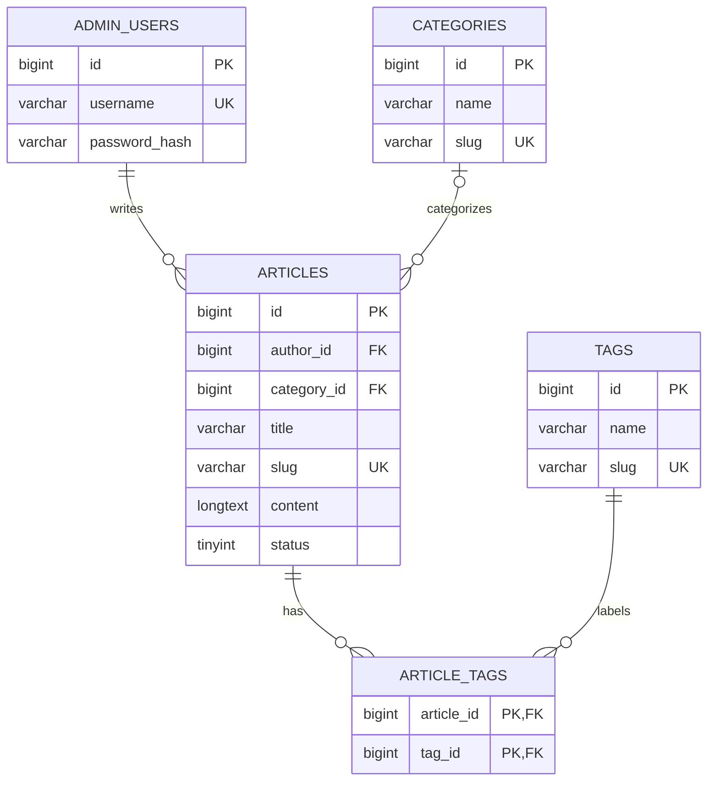

# 个人博客数据库表结构设计

> 版本：V1.0  
> 数据库示例：MySQL 8.0  
> 目标：支撑个人博客前后端搭建、本地联调与 Docker 部署。AI 问答、评论和社区功能暂不纳入第一版。

## 1. 设计目标与范围

第一版数据库优先满足以下需求：

- 后台管理员登录。
- 文章分类与标签管理。
- 文章创建、编辑、保存草稿、发布和下线。
- 文章列表、详情及基础 SEO 信息。
- 网站名称、简介、访问地址等基础配置。
- 为后续功能预留合理扩展空间，但不提前建设复杂的多用户或社区模型。

### 1.1 数据表清单

| 表名 | 用途 | 第一版是否需要 |
|---|---|---|
| `admin_users` | 后台管理员账号 | 是 |
| `categories` | 文章分类 | 是 |
| `tags` | 文章标签 | 是 |
| `articles` | 文章正文、状态和元信息 | 是 |
| `article_tags` | 文章与标签的多对多关联 | 是 |
| `site_settings` | 网站基础配置 | 建议 |
| `article_views` | 独立浏览记录明细 | 暂不需要；第一版可使用 `articles.view_count` |

## 2. 表关系



## 3. 完整 SQL 建表脚本

建议将以下脚本保存为 `sql/001_init_schema.sql`，并通过项目数据库迁移机制执行。数据库和数据库账号建议由环境变量或部署配置创建，不要将真实密码写入 SQL 文件或代码仓库。

```sql
-- MySQL 8.0+
-- 个人博客第一版数据库结构

SET NAMES utf8mb4;

-- 1. 后台管理员
CREATE TABLE IF NOT EXISTS admin_users (
    id BIGINT UNSIGNED NOT NULL AUTO_INCREMENT,
    username VARCHAR(50) NOT NULL,
    password_hash VARCHAR(255) NOT NULL,
    display_name VARCHAR(100) NOT NULL DEFAULT '',
    email VARCHAR(255) DEFAULT NULL,
    is_active TINYINT UNSIGNED NOT NULL DEFAULT 1,
    last_login_at DATETIME DEFAULT NULL,
    created_at DATETIME NOT NULL DEFAULT CURRENT_TIMESTAMP,
    updated_at DATETIME NOT NULL DEFAULT CURRENT_TIMESTAMP
        ON UPDATE CURRENT_TIMESTAMP,
    PRIMARY KEY (id),
    UNIQUE KEY uk_admin_users_username (username),
    UNIQUE KEY uk_admin_users_email (email),
    KEY idx_admin_users_active (is_active)
) ENGINE=InnoDB
  DEFAULT CHARSET=utf8mb4
  COLLATE=utf8mb4_unicode_ci
  COMMENT='后台管理员';

-- 2. 文章分类
CREATE TABLE IF NOT EXISTS categories (
    id BIGINT UNSIGNED NOT NULL AUTO_INCREMENT,
    name VARCHAR(100) NOT NULL,
    slug VARCHAR(150) NOT NULL,
    description VARCHAR(500) DEFAULT NULL,
    sort_order INT NOT NULL DEFAULT 0,
    created_at DATETIME NOT NULL DEFAULT CURRENT_TIMESTAMP,
    updated_at DATETIME NOT NULL DEFAULT CURRENT_TIMESTAMP
        ON UPDATE CURRENT_TIMESTAMP,
    PRIMARY KEY (id),
    UNIQUE KEY uk_categories_name (name),
    UNIQUE KEY uk_categories_slug (slug),
    KEY idx_categories_sort (sort_order, id)
) ENGINE=InnoDB
  DEFAULT CHARSET=utf8mb4
  COLLATE=utf8mb4_unicode_ci
  COMMENT='文章分类';

-- 3. 文章标签
CREATE TABLE IF NOT EXISTS tags (
    id BIGINT UNSIGNED NOT NULL AUTO_INCREMENT,
    name VARCHAR(100) NOT NULL,
    slug VARCHAR(150) NOT NULL,
    created_at DATETIME NOT NULL DEFAULT CURRENT_TIMESTAMP,
    updated_at DATETIME NOT NULL DEFAULT CURRENT_TIMESTAMP
        ON UPDATE CURRENT_TIMESTAMP,
    PRIMARY KEY (id),
    UNIQUE KEY uk_tags_name (name),
    UNIQUE KEY uk_tags_slug (slug)
) ENGINE=InnoDB
  DEFAULT CHARSET=utf8mb4
  COLLATE=utf8mb4_unicode_ci
  COMMENT='文章标签';

-- 4. 文章
CREATE TABLE IF NOT EXISTS articles (
    id BIGINT UNSIGNED NOT NULL AUTO_INCREMENT,
    author_id BIGINT UNSIGNED NOT NULL,
    category_id BIGINT UNSIGNED DEFAULT NULL,

    title VARCHAR(200) NOT NULL,
    slug VARCHAR(220) NOT NULL,
    summary VARCHAR(500) DEFAULT NULL,
    content LONGTEXT NOT NULL,
    cover_image VARCHAR(1000) DEFAULT NULL,

    status TINYINT UNSIGNED NOT NULL DEFAULT 0
        COMMENT '0=草稿, 1=已发布, 2=已下线',

    is_top TINYINT UNSIGNED NOT NULL DEFAULT 0
        COMMENT '0=普通, 1=置顶',

    allow_comment TINYINT UNSIGNED NOT NULL DEFAULT 0
        COMMENT '预留评论功能，第一版不实现评论',

    view_count BIGINT UNSIGNED NOT NULL DEFAULT 0,

    seo_title VARCHAR(200) DEFAULT NULL,
    seo_description VARCHAR(500) DEFAULT NULL,

    published_at DATETIME DEFAULT NULL,
    created_at DATETIME NOT NULL DEFAULT CURRENT_TIMESTAMP,
    updated_at DATETIME NOT NULL DEFAULT CURRENT_TIMESTAMP
        ON UPDATE CURRENT_TIMESTAMP,

    PRIMARY KEY (id),
    UNIQUE KEY uk_articles_slug (slug),
    KEY idx_articles_status_published (status, published_at, id),
    KEY idx_articles_category_status (category_id, status, published_at),
    KEY idx_articles_author (author_id),
    KEY idx_articles_top (is_top, status, published_at),

    CONSTRAINT fk_articles_author
        FOREIGN KEY (author_id) REFERENCES admin_users(id)
        ON UPDATE RESTRICT ON DELETE RESTRICT,

    CONSTRAINT fk_articles_category
        FOREIGN KEY (category_id) REFERENCES categories(id)
        ON UPDATE RESTRICT ON DELETE SET NULL,

    CONSTRAINT chk_articles_status
        CHECK (status IN (0, 1, 2)),

    CONSTRAINT chk_articles_top
        CHECK (is_top IN (0, 1))
) ENGINE=InnoDB
  DEFAULT CHARSET=utf8mb4
  COLLATE=utf8mb4_unicode_ci
  COMMENT='博客文章';

-- 5. 文章与标签的关联表
CREATE TABLE IF NOT EXISTS article_tags (
    article_id BIGINT UNSIGNED NOT NULL,
    tag_id BIGINT UNSIGNED NOT NULL,
    created_at DATETIME NOT NULL DEFAULT CURRENT_TIMESTAMP,

    PRIMARY KEY (article_id, tag_id),
    KEY idx_article_tags_tag (tag_id, article_id),

    CONSTRAINT fk_article_tags_article
        FOREIGN KEY (article_id) REFERENCES articles(id)
        ON UPDATE RESTRICT ON DELETE CASCADE,

    CONSTRAINT fk_article_tags_tag
        FOREIGN KEY (tag_id) REFERENCES tags(id)
        ON UPDATE RESTRICT ON DELETE CASCADE
) ENGINE=InnoDB
  DEFAULT CHARSET=utf8mb4
  COLLATE=utf8mb4_unicode_ci
  COMMENT='文章标签关联';

-- 6. 网站配置
CREATE TABLE IF NOT EXISTS site_settings (
    id BIGINT UNSIGNED NOT NULL AUTO_INCREMENT,
    setting_key VARCHAR(100) NOT NULL,
    setting_value TEXT DEFAULT NULL,
    description VARCHAR(255) DEFAULT NULL,
    updated_at DATETIME NOT NULL DEFAULT CURRENT_TIMESTAMP
        ON UPDATE CURRENT_TIMESTAMP,
    PRIMARY KEY (id),
    UNIQUE KEY uk_site_settings_key (setting_key)
) ENGINE=InnoDB
  DEFAULT CHARSET=utf8mb4
  COLLATE=utf8mb4_unicode_ci
  COMMENT='网站配置';

-- 网站基础配置初始化
INSERT IGNORE INTO site_settings
    (setting_key, setting_value, description)
VALUES
    ('site_name', '我的个人博客', '网站名称'),
    ('site_description', '记录学习过程，分享兴趣爱好', '网站简介'),
    ('site_url', '', '网站公开访问地址');
```

## 4. 字段说明

### 4.1 `admin_users`：后台管理员

| 字段 | 类型 | 说明 |
|---|---|---|
| `id` | `BIGINT UNSIGNED` | 主键 |
| `username` | `VARCHAR(50)` | 登录用户名，唯一 |
| `password_hash` | `VARCHAR(255)` | 密码哈希，禁止存储明文密码 |
| `display_name` | `VARCHAR(100)` | 后台显示名称 |
| `email` | `VARCHAR(255)` | 邮箱，可为空 |
| `is_active` | `TINYINT UNSIGNED` | 是否启用：1 启用、0 禁用 |
| `last_login_at` | `DATETIME` | 最近登录时间 |
| `created_at` / `updated_at` | `DATETIME` | 创建和更新时间 |

密码哈希应由后端使用经过验证的密码哈希算法生成，例如 Argon2id 或 bcrypt。不要在数据库迁移脚本中写入默认明文密码。

### 4.2 `categories`：文章分类

- `name`：分类名称。
- `slug`：用于 URL 的唯一标识，例如 `backend-development`。
- `description`：分类简介。
- `sort_order`：列表排序值，具体排序规则由后端统一定义。

### 4.3 `tags`：文章标签

- `name`：标签名称。
- `slug`：标签 URL 标识。
- `article_tags` 使用联合主键，防止同一篇文章重复关联同一个标签。

### 4.4 `articles`：文章

| 字段 | 说明 |
|---|---|
| `author_id` | 创建文章的管理员 ID |
| `category_id` | 分类 ID，可为空 |
| `title` | 文章标题 |
| `slug` | 唯一 URL 标识 |
| `summary` | 文章摘要 |
| `content` | 正文，可保存 Markdown 或经后端约定的内容格式 |
| `cover_image` | 封面图片 URL 或相对路径 |
| `status` | 0 草稿、1 已发布、2 已下线 |
| `is_top` | 是否置顶 |
| `allow_comment` | 预留字段；第一版不实现评论 |
| `view_count` | 浏览次数计数器 |
| `seo_title` | SEO 标题 |
| `seo_description` | SEO 描述 |
| `published_at` | 发布时间 |
| `created_at` / `updated_at` | 创建和更新时间 |

**发布规则：**

1. 公开 API 只能返回 `status = 1` 的文章。
2. 草稿和下线文章只能由有权限的后台接口读取或修改。
3. 首次发布时设置 `published_at`；编辑已发布文章时，不应无条件覆盖原发布时间。
4. `slug` 必须唯一。修改 slug 时，需要考虑旧链接兼容策略。
5. 文章删除和分类删除的行为应由业务层明确约定，避免误删内容。

### 4.5 `site_settings`：网站配置

建议用于保存网站名称、网站简介、公开访问地址等非敏感配置。数据库密码、JWT 密钥、第三方 API Key 等机密信息应保存在环境变量或专用密钥管理系统中，而不是此表中。

## 5. 关键索引与约束说明

- `uk_articles_slug`：保证文章链接唯一。
- `idx_articles_status_published`：支持按发布状态和时间查询文章列表。
- `idx_articles_category_status`：支持分类文章列表。
- `idx_article_tags_tag`：支持查询某个标签下的文章。
- 外键保证文章、分类、标签之间的引用关系有效。
- 删除文章时自动删除 `article_tags` 关联记录；删除分类时文章的 `category_id` 置空；管理员被文章引用时禁止直接删除。

> 注：MySQL 8.0 的具体小版本、迁移工具及数据库配置仍需在项目中验证。`CHECK` 约束的实际执行行为取决于 MySQL 版本；业务层仍应验证状态值。

## 6. 第一版暂不创建的表

| 功能 | 暂缓原因 | 后续可能增加的表 |
|---|---|---|
| AI 问答 | 明确安排到后期 | `ai_conversations`、`ai_messages` |
| 评论 | 当前不需要 | `comments` |
| 多用户注册 | 个人博客第一版不需要 | `users` |
| 独立浏览记录 | 第一版计数器已足够 | `article_views` |
| 操作审计 | 可在基础功能稳定后评估 | `admin_audit_logs` |

这些表名仅为后续设计参考，不代表现在需要创建。

## 7. 初始化与验证建议

1. 确认后端实际使用的数据库类型和版本。
2. 将 SQL 纳入数据库迁移流程，不要只依赖手工执行。
3. 通过安全的初始化流程创建首个管理员，并生成密码哈希。
4. 验证分类、标签、文章之间的外键和唯一约束。
5. 验证草稿、发布、下线三种状态的访问权限。
6. 通过 Docker Compose 启动数据库后，确认数据卷持久化有效。
7. 在前后端联调前，先使用后端测试或 API 工具验证核心数据读写流程。

## 8. 后续需要与实际后端核对的事项

这份设计是第一版建议方案，不应直接视为已与现有后端完全匹配。实施前应核对：

- 后端框架、ORM 与现有实体类。
- 当前数据库类型、版本及已有迁移。
- `API_SPEC.md` 中文章、分类、标签和登录接口的字段约定。
- 正文采用 Markdown、HTML 还是其他格式。
- 登录采用 Cookie Session 还是 Token。
- 是否已有管理员表或文章表，是否需要兼容旧数据。

如果已有表结构和代码与本文不同，应优先评估兼容和迁移方案，避免直接删除或覆盖现有数据。
